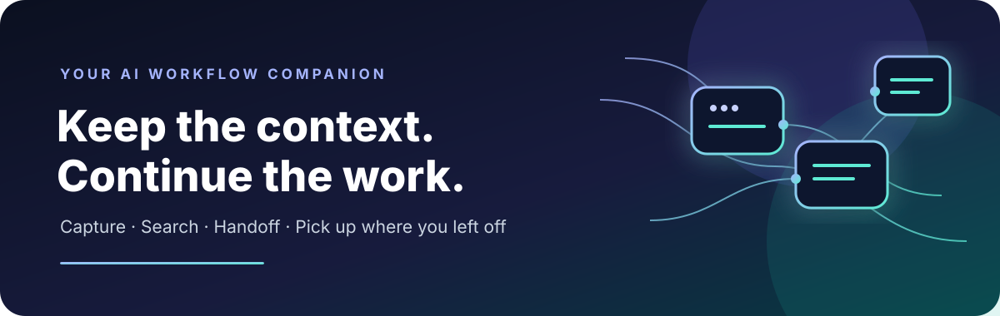

<div align="center">

  

  <h1>ContextShift Ultimate</h1>

  <p><strong>Your AI conversations, organized and ready to move.</strong></p>
  <p>Capture useful context, search your saved conversations, and create a handoff you can take to another AI assistant.</p>

  <p>
    
    
    
    
  </p>

  <p>
    <a href="#-features">Features</a> ·
    <a href="#-install">Install</a> ·
    <a href="#-how-to-use">How to use</a> ·
    <a href="#-privacy">Privacy</a> ·
    <a href="#-contributing">Contributing</a>
  </p>
</div>

---

## ✨ Why ContextShift?

Ever had to explain the same project, preferences, or debugging history again when switching between AI tools? ContextShift Ultimate is a Chrome extension prototype designed to help reduce that repetition.

It brings your conversations into a small, searchable personal library and helps turn selected context into a handoff you can paste into another assistant.

> **The idea:** spend less time re-explaining, and more time continuing your work.

## 🚀 Features

| Feature | What it helps you do |
| --- | --- |
| 🧩 **Capture context** | Save conversation content from supported AI chat websites. |
| 📚 **Personal library** | Keep saved context in one place inside the extension. |
| 🔎 **Search** | Find saved items instead of scrolling through old chats. |
| 🔁 **AI handoff** | Prepare a structured context note to carry into another assistant. |
| 📤 **Export** | Export saved context for your own use. |
| 🖥️ **Browser-native** | Built as a Chrome extension using Manifest V3. |

### 🌐 Supported websites

The current prototype includes page support for:

- [ChatGPT](https://chatgpt.com/)
- [Claude](https://claude.ai/)
- [Google Gemini](https://gemini.google.com/)
- [Grok](https://grok.com/)
- [Perplexity](https://www.perplexity.ai/)

AI websites can change their page structure at any time, so capture behavior may vary and may need maintenance.

## 📦 Install

> **Current distribution:** install from source using Chrome Developer mode. This project is not currently listed on the Chrome Web Store.

1. Open the [latest repository code](https://github.com/Anikesh0001/ContextShift-Ultimate).
2. Click **Code → Download ZIP**, then extract the ZIP to a folder you can keep.
3. In Chrome, open `chrome://extensions`.
4. Turn on **Developer mode**.
5. Select **Load unpacked**.
6. Choose the extracted project folder — the one containing `manifest.json`.
7. Open one of the supported AI chat websites and select the ContextShift extension icon.

**Updating:** download and extract the newer version, then use **Reload** on the extension card (or load the updated folder). Keep your existing extension storage in mind when changing or removing installations.

## 🧭 How to use

1. Open a supported AI conversation in Chrome.
2. Open ContextShift Ultimate from the browser toolbar.
3. Use the available capture action to save useful context.
4. Search and review items in your library.
5. Prepare a handoff note when continuing the work in another AI assistant.
6. Export your saved context when you need a portable copy.

The exact controls and extraction results depend on the current extension build and the page layout of the AI website.

## 🔐 Privacy

Conversations can contain personal, confidential, or work-related information. Please use the extension thoughtfully.

- The project is designed around a **local-first** workflow.
- Review the code and your browser's extension permissions before use.
- Only capture content you are allowed to store.
- Avoid saving passwords, secrets, access tokens, private customer data, or other sensitive information.
- Removing the extension or clearing browser data can affect locally stored information; export anything you need to keep first.

**Important:** “Local-first” is not a guarantee that every possible code path has been independently security-audited. This is a community preview, and you should review the source before using it with sensitive conversations. See the [LICENSE](LICENSE) file for licensing terms.

## 🛠️ Project structure

```text
ContextShift-Ultimate/
├── manifest.json       # Chrome extension configuration
├── background.js       # Background/service-worker behavior
├── content.js          # Conversation-page integration
├── content.css         # Page-level styles
├── popup.html          # Extension popup interface
├── popup.js            # Popup interactions
├── popup.css           # Popup styling
├── tests/
│   └── smoke-test.js   # Lightweight smoke checks
├── assets/
│   └── contextshift-banner.svg
├── README.md
└── LICENSE
```

Some files or directories may differ between versions; the repository contents for your checked-out revision are authoritative.

## 🧪 Testing status

The project includes lightweight smoke checks for basic project structure and selected code markers. These checks do **not** replace full end-to-end browser tests, cross-site compatibility checks, or a comprehensive privacy/security audit.

If you find an issue, please open a GitHub issue with:
- The AI website and browser version.
- Steps to reproduce the issue.
- Expected versus actual behavior.
- Console errors, with any personal or confidential content removed.

## 🗺️ Roadmap

- [ ] Add clear first-run explanation and capture controls.
- [ ] Improve resilient conversation extraction across supported sites.
- [ ] Expand automated browser-level tests.
- [ ] Review data handling and privacy disclosures before wider distribution.
- [ ] Improve accessibility and keyboard navigation.
- [ ] Prepare a Chrome Web Store submission after testing and policy review.

## 🤝 Contributing

Contributions, bug reports, and thoughtful feature ideas are welcome.

1. Fork the repository.
2. Create a branch for your change.
3. Make a focused change and test it.
4. Open a pull request describing what changed and how you tested it.

Please do not include real conversations, credentials, or private user data in issues, test fixtures, or screenshots.

## 📃 License

See [LICENSE](LICENSE) for the license and conditions that apply to this project.

## 💬 Support

Found a bug or have an idea? [Open an issue](https://github.com/Anikesh0001/ContextShift-Ultimate/issues).

---

<div align="center">

  **Keep the context. Continue the work.**

  <sub>Built as an independent community project. ChatGPT, Claude, Gemini, Grok, and Perplexity are names of their respective owners; this project is not affiliated with or endorsed by them.</sub>

</div>
